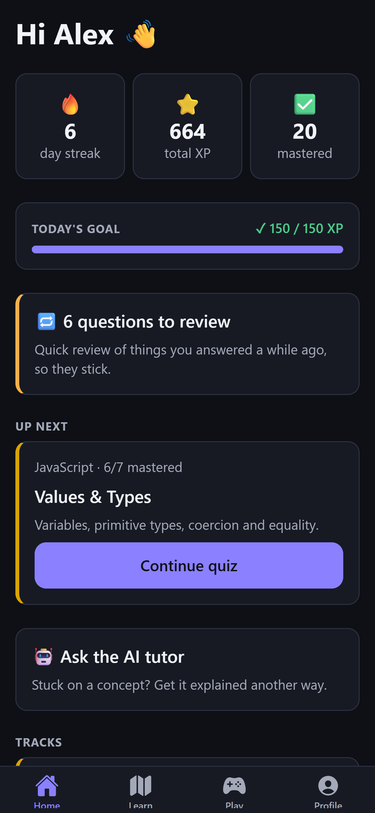
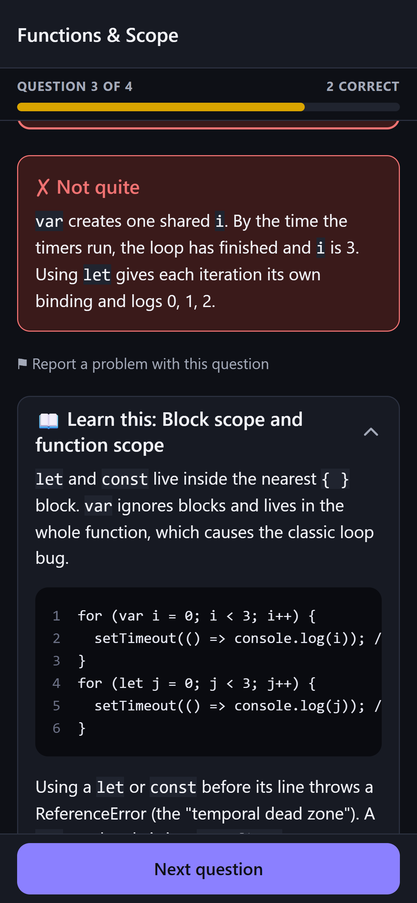
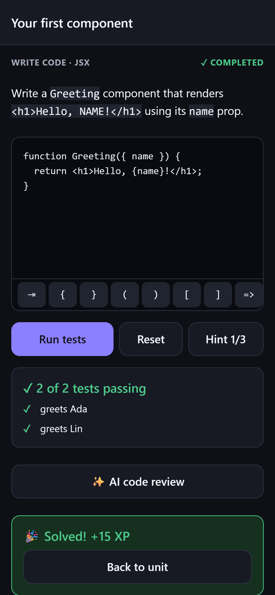

# DevQuest

A gamified mobile app for learning JavaScript, TypeScript, React and Next.js through
quizzes, games, coding exercises, debugging challenges and small builds, with an
optional AI question bank and tutor.

Built with Expo (SDK 58), Expo Router, TypeScript (strict) and Zustand. Optional
Supabase for accounts and sync, and a small Node server for AI features.
## Screenshots

<p align="center">
  
  
  
</p>

## What's in the app

- **Quizzes**: every unit is a quiz with 8 question types. A wrong answer opens a
  short "Learn this" note on that topic. XP, streaks, a daily goal and topic mastery.
- **Spaced review**: missed questions come back the next day; right ones return
  after longer and longer gaps (1, 3, 7, 16, 35 days).
- **Coding exercises**: a phone-friendly code editor (symbol keys, tab) with tests
  that run in an isolated sandbox. Three hints, then the model solution (half XP).
- **Debugging challenges**: fix the code until the tests pass, or, for errors that
  can't run here (hydration, React warnings), tap the lines that cause them.
- **Mini-games** (Play tab): Bug Hunter and Output Rush, 60 seconds each.
- **Build projects**: one per track, in steps, with a live preview powered by the
  learner's own code: a tip calculator, a form validator, a todo app rendered as
  HTML, and a mini Next.js App Router with a simulated browser.
- **AI** (needs the server): fresh quizzes on your weak topics, an AI tutor chat,
  AI hints and AI code review. Every AI question is checked before it is shown.
- **Accounts and sync** (needs Supabase): back up progress and continue on another
  phone; weekly leaderboard.
- **Achievements**: 15 badges with XP rewards.
- **Report a problem** on any question; reports feed an admin review queue.

Everything except AI and sync works offline.

## Run it

```bash
npm install
cp .env.example .env.local     # optional: AI server and Supabase settings
npm run web                    # in the browser
npm start                      # then scan the QR code with Expo Go, or press a / i
```

## The DevQuest server (AI features)

```bash
cp server/.env.example server/.env   # add GEMINI_API_KEY (Google AI Studio) or ANTHROPIC_API_KEY
npm run server                       # http://localhost:8787
```

Set `EXPO_PUBLIC_AI_SERVER_URL` in `.env.local` (on a phone, use your computer's LAN
address, e.g. `http://192.168.1.20:8787`) and restart the app. Without it, AI buttons
are hidden and quizzes use the built-in questions.

| Endpoint | What it does |
| --- | --- |
| `POST /api/quiz` | AI questions for a unit: reused from the bank first, generated only when needed |
| `POST /api/hint`, `/api/review` | AI hint / code review for an exercise (the server looks up the real task) |
| `POST /api/tutor` | Tutor chat, limited to web development |
| `POST /api/typecheck` | Strict TypeScript check for "add types" exercises |
| `POST /api/report` | A learner reports a question |
| `GET /admin` | Review queue (set `DEVQUEST_ADMIN_TOKEN`) |

How AI questions stay correct: each one runs through the same checks as the built-in
content (`server/checks/`). The code in "what does this log?" questions is executed and
compared with the marked answer, indexes and line numbers are validated, and the quiz
grader must accept the right answer and reject a wrong one. Failures are discarded.
Two learner reports hide an AI question until you review it at `/admin`; with
`DEVQUEST_REVIEW_NEW=true` every new question waits for approval.

With Gemini the default model is `gemini-3.8-flash`, falling back to
`gemini-3.5-flash-lite` when it is busy or doesn't reply within 45 s. All settings are
listed in `server/.env.example`. The question bank and reports are JSON files in
`server/data/`; swap `server/store.ts` for a database when you have real users.

## Accounts and sync (Supabase)

1. Create a free project at supabase.com.
2. In the dashboard, open **SQL Editor**, paste `supabase/schema.sql` and run it. It
   creates the `progress` and `leaderboard` tables with row-level security.
3. In **Authentication → Providers**, keep Email enabled. For quick testing you can
   turn off "Confirm email".
4. Copy the project URL and publishable key into `.env.local`
   (`EXPO_PUBLIC_SUPABASE_URL`, `EXPO_PUBLIC_SUPABASE_PUBLISHABLE_KEY`) and restart.

Progress is stored as event lists (answers and rewards), so syncing is a merge and can
never double-count XP, whichever device syncs first.

## Checks

```bash
npm run check   # everything below in one go
npm run typecheck
npm run lint
npm test               # unit tests (quiz grading, streaks, sync merge, reviews, sandbox, mini React)
npm run verify:seed    # runs every question, exercise, debug challenge, project and preview
npm run test:ai-checks # broken AI questions must be rejected for the right reason
```

`verify:seed` runs every piece of content twice: in Node with the real React, and through
the app's own pipeline (sucrase + the sandbox's mini React). They must agree, so content
that passes here also passes on the phone.

## Layout

| Path | What lives there |
| --- | --- |
| `src/app/` | Screens (Expo Router): tabs, onboarding, track → unit → quiz / exercise / debug, project, game, tutor, account, leaderboard |
| `src/components/` | Shared UI; `code/` holds the editor, sandbox frame, previews and AI assist |
| `src/content/` | Seed content per track, topic notes (`notes/`), project previews |
| `src/lib/` | Quiz engine, stats, reviews, games, achievements, sync, AI client, `runner/` (sandbox) |
| `src/store/` | Persisted Zustand stores: progress (events), settings, code drafts |
| `server/` | AI server: providers, checks, assistant, admin review queue |
| `supabase/schema.sql` | Database tables and security rules |
| `scripts/`, `tests/` | Content verifier, AI-check test, unit tests |

## Before publishing to the stores

- Replace the template icon and splash images in `assets/images/`.
- Choose your app IDs: add `ios.bundleIdentifier` and `android.package` to `app.json`
  (for example `com.yourname.devquest`). They can't change after the first release.
- Host the server with HTTPS, set `DEVQUEST_ALLOWED_ORIGIN`, a strong
  `DEVQUEST_ADMIN_TOKEN`, and keep the hourly limits. Learner code from AI questions is
  only run on the server inside the checks; consider a separate container for it.
- Publish a privacy policy: progress syncs to Supabase, and quiz, tutor and code text is
  sent to your server and on to Google or Anthropic.
- Build with EAS: `npx eas-cli@latest build`, then `npx eas-cli@latest submit`.
- Test on real Android and iOS devices first (the sandbox uses a WebView there).
